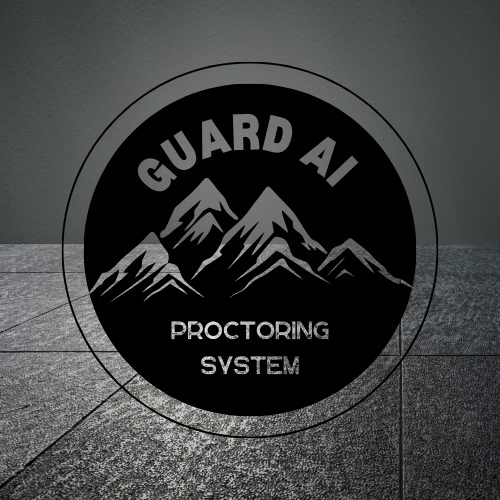
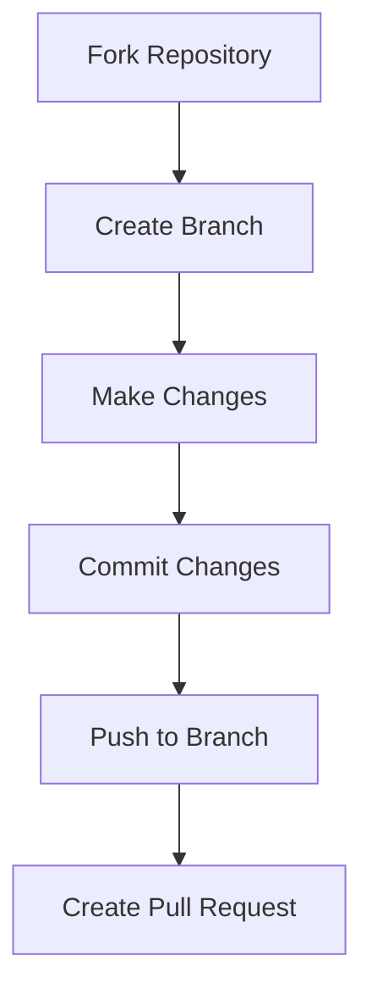

<div style="display: flex; align-items: center; justify-content: center; padding: 20px; background-color: #1e1e2f; color: white; height: 150px;">
    <h2>🎉 Transforming Remote Assessments with AI!!! 🎉</h2>
</div>

# `AI-Based Proctoring System for Secure Assessments 🔒`

[](https://www.python.org/)
[](https://fastapi.tiangolo.com/)
[](LICENSE)
[](CONTRIBUTING.md)
[](https://swoc.tech)
[](https://github.com/Hiteshydv001/Guard-AI/graphs/contributors)

<p align="center">
  An open-source initiative to transform remote assessment integrity using cutting-edge AI technology. </p>

[🌟 Features](#-features) 
[⚙️ Installation](#️-installation) 
[🏗️ Architecture](#️-architecture--design) 
[🚀 Usage](#-usage) 
[🤝 Contributing](#-contributing) 
[👥 Community](#-community)

---

<p align="center">
  
</p>

---

## Contributing Guide

Please refer to our [CONTRIBUTING.md](./CONTRIBUTING.md) for contribution guidelines.

---

## 📄 `Provide Your Feedback or Participate`

We value your feedback! Please take a moment to fill out the Google Form and contribute to improving our project.

[📋 Google Form - Participate Now!](https://docs.google.com/forms/d/e/1FAIpQLSdqqOSG82asLvwYaL6YfR35y2m6t_x_j7SHeS3W4636mzM-oQ/viewform?usp=dialog)

---

<table align="center">
    <thead align="center">
        <tr border: 1px;>
            <td><b>🌟 Stars</b></td>
            <td><b>🍴 Forks</b></td>
            <td><b>🐛 Issues</b></td>
            <td><b>🔔 Open PRs</b></td>
            <td><b>🔕 Close PRs</b></td>
        </tr>
     </thead>
    <tbody>
         <tr>
            <td></td>
             <td></td>
            <td></td>
            <td></td>
           <td></td>
        </tr>
    </tbody>
</table>
</div>


## 🌟 `Overview`
This project introduces a cutting-edge **AI-powered proctoring system** designed to maintain **fairness**, **security**, and **integrity** in remote assessments. By leveraging advanced machine learning techniques, this system redefines how online tests are monitored.

## 🏆 `Featured In`

<div align="center">

<table>
   <tr>
      <td></td>
      <td>Social Winter Of Code</td>
      <td>Social Winter of Code is an initiative to introduce students to the open-source world, fostering collaboration and development.</td>
   </tr>
   <tr>
      <td></td>
      <td>Delta Winter Of Code</td>
      <td>Delta Winter of Code empowers students by providing opportunities to contribute to meaningful open-source projects and grow their skills.</td>
   </tr>
    <tr>
      <td></td>
      <td>JWOC Winter of Code</td>
      <td>JWoC provides a fully immersive learning experience for students and first-time contributors by promoting the wonders of open-source software and crafting a community of new and experienced technical developers. The best projects are selected for this program. Students get acquainted with the projects from the mentors during the Community Bonding Period. Students work on these projects during the coding phase. At the end of the coding period, the winners of the programs are announced on the basis of their contribution in terms of quantity as well as quality.</td>
   </tr>
</table>


</div>


## 📺 `Project Demo`

Watch our community demo:

[🎥 Watch Demo]()

---

## `🌟 Features`

**For teachers / proctors**
- **Student management** — create student accounts (Clerk) with generated passwords, bulk import from CSV, email invites, reset passwords, link existing students by email
- **Batches** — group students into classes and assign exams to batches; restrict an exam to assigned students only
- **Face ID** — upload a reference photo per student; identity is verified before the exam and re-checked during it
- **Teacher assistant** — chat to create exams (AI writes the questions), invite students, publish and read results; powered by Groq, and anything that emails people, publishes or deletes waits for an approve click
- **Branded invitations** — invite emails sent from your own domain via Resend (falls back to Clerk's email); revoked or expired links get a clear explanation
- **Exam builder** — single / multiple choice and written questions, explanations, schedule window, shuffle questions & options, pass mark, auto-terminate after *N* flags, duplicate exams
- **Live monitoring** — webcam thumbnails, online status, identity badge, head-pose / object readings, risk score, warn or end an attempt in one click
- **Evidence review** — timeline of every AI and browser flag with snapshots, reference photo vs. live frame, manual identity approval, grading for written answers
- **Analytics & export** — score distribution, pass rate, per-question accuracy, flag breakdown, 14-day activity, CSV export of results

**For students**
- Assigned exams appear on the dashboard (or join with an access code)
- Guided pre-exam flow: camera/mic check → identity verification → head-pose calibration → rules
- Distraction-free exam UI with question navigator, autosave, server-authoritative timer and auto-submit
- Results page with per-question breakdown (when the teacher enables it)

**Server-side AI proctoring** — the browser only uploads a compressed frame every ~1.5 s; all analysis runs on the API server:

| Signal | Model / method |
| --- | --- |
| Face count, no face, multiple people | **YuNet** face detector (OpenCV, MIT) + YOLOX person class |
| Prolonged looking away, frequent head movement | **MediaPipe Face Landmarker** head pose vs. the candidate's calibrated neutral pose (port of the original `anomaly_detection.py` rules) |
| Eyes off screen, talking | Face Landmarker gaze & jaw blendshapes + browser audio level |
| Phone, book/notes, extra laptop | **YOLOX-Tiny** object detector (ONNX, Apache-2.0) |
| Identity verification & mid-exam swap | **SFace** face embeddings (OpenCV, Apache-2.0), cosine match against the teacher-uploaded photo |
| Camera covered | Frame brightness |
| Tab switch, window blur, fullscreen exit, copy/paste, extra monitor | Browser events |

All models are permissively licensed (no AGPL), CPU-only, ~65 MB total, ~100–130 ms per frame. Object detection runs on
every 2nd frame and identity on every 8th, so a single vCPU handles roughly 8–12 concurrent candidates; the server
tells browsers to slow down automatically when frames queue up.

## `🏗️ Architecture & Design`

```
 Student browser ── JPEG frame + audio level every ~1.5 s ──┐        ┌── Teacher browser (live grid polls 3 s)
                                                            ▼        ▼
                     Next.js 14 on Vercel  (Clerk auth, UI only)
                                     │  Bearer <Clerk session JWT>
                                     ▼
       FastAPI on Railway ─ verifies JWT (Clerk JWKS), Clerk Backend API for student accounts
        ├─ AI runtime: YuNet · Face Landmarker · SFace · YOLOX-Tiny (bounded worker pool, back-pressure)
        ├─ Per-attempt anomaly tracker + in-memory live cache (thumbnails never hit the DB)
        └─ Alembic-migrated schema
              │                                   │
              ▼                                   ▼
     Supabase Postgres (RLS on)        Supabase Storage (private bucket: evidence + reference photos,
                                                          served via short-lived signed URLs)
```

Design notes:
- **No video is stored.** Frames are analysed in memory; only flagged moments are saved as evidence snapshots.
- **Answer keys never leave the server**; grading, timing and auto-termination are server-authoritative.
- **Single API instance** by design: the AI runtime and live cache are in-process (Railway's default).

## `🔧 Technology Stack`

| Layer | Tech | Free hosting |
| --- | --- | --- |
| Frontend | Next.js 14 (App Router), Tailwind, shadcn/ui, Recharts | Vercel Hobby |
| Auth | Clerk (sessions + Backend API for student accounts) | Clerk free tier |
| Backend | FastAPI, SQLAlchemy 2 (async), Alembic, PyJWT, httpx | Railway |
| AI | OpenCV (YuNet, SFace), MediaPipe Tasks, ONNX Runtime (YOLOX) | Railway (CPU) |
| Database | PostgreSQL | Supabase free tier |
| Storage | Supabase Storage | Supabase free tier (1 GB) |
| CI | GitHub Actions — ruff, pytest, Docker smoke test, Next.js lint/typecheck/build | free for public repos |

## `⚙️ Development Setup`

**Prerequisites:** Node 18+ with pnpm, Python 3.12+, a free [Clerk](https://clerk.com) application with
*Email address* + *Password* sign-in enabled.

**1. Backend**

```bash
cd backend
python -m venv .venv
.venv/Scripts/activate                          # macOS/Linux: source .venv/bin/activate
pip install -r requirements-dev.txt
pip install --no-deps -r requirements-mediapipe.txt
python scripts/download_models.py               # ~65 MB of model weights into backend/models/
cp .env.example .env                            # set CLERK_ISSUER and CLERK_SECRET_KEY
uvicorn app.main:app --reload --port 8000 --env-file .env
```

Migrations run automatically on startup (SQLite file `guardai_dev.db` locally). Tests: `pytest -q`.

**2. Frontend**

```bash
cd main-web-vecel
pnpm install
cp .env.example .env.local                      # Clerk keys + NEXT_PUBLIC_API_URL=http://localhost:8000
pnpm dev                                        # http://localhost:3000
```

Sign up, choose **"I conduct exams"**, add a student under **Students** (copy the generated password), upload their
photo, create a batch, build an exam assigned to it and publish. Sign in as the student in a private window.

## `☁️ Free Deployment Guide`

**1. Supabase (database + storage)**
1. Create a project at [supabase.com](https://supabase.com).
2. *Project Settings → Database → Connection string*: copy the **Transaction pooler** URI (port `6543`) → `DATABASE_URL`.
3. *Project Settings → API*: Project URL → `SUPABASE_URL`, `service_role` key → `SUPABASE_SERVICE_ROLE_KEY` (server only).
4. Nothing else — the API runs its Alembic migrations (with RLS enabled) and creates the private `evidence` bucket on boot.

**2. Clerk (auth)**
1. Create an application; enable *Email address* and *Password*. Copy the publishable and secret keys.
2. *API keys → Frontend API URL* → `CLERK_ISSUER`.

**3. Railway (backend + AI)**
1. *New Project → Deploy from GitHub repo*; in the service settings set **Root Directory** to `backend`.
   Railway builds `backend/Dockerfile` (models are baked into the image; health check `/health`).
2. Variables: `DATABASE_URL`, `CLERK_ISSUER`, `CLERK_SECRET_KEY`, `SUPABASE_URL`, `SUPABASE_SERVICE_ROLE_KEY`,
   `CORS_ORIGINS=https://<your-app>.vercel.app`, `FRONTEND_URL=https://<your-app>.vercel.app`, `ML_CONCURRENCY=1`
   (use `2` on a 2-vCPU plan).
3. *Settings → Networking → Generate Domain*. Keep **one replica** (in-process AI runtime).

**4. Vercel (frontend)**
1. *Import* the repo, **Root Directory** `main-web-vecel`.
2. Environment variables from `main-web-vecel/.env.example`, with `NEXT_PUBLIC_API_URL=https://<your-api>.up.railway.app`.
3. Deploy, then make sure the Vercel URL is in `CORS_ORIGINS` on Railway.

> **Capacity on free tiers.** The image needs ~450 MB RAM with models loaded. Railway's free plan fits a demo or a
> small class. Frames arrive every second; the phone/object detector runs on every frame while the CPU has headroom
> (phone flagged in ~1–1.5 s, ~5 candidates per vCPU), then thins to every 2nd/3rd frame as load rises (~8–11 per vCPU),
> always running on frames with a suspicious cue such as eyes or head down. For larger exams use a 2+ vCPU plan and
> raise `ML_CONCURRENCY`. Supabase pauses free projects after ~1 week of inactivity (one click to resume).

## `📁 Project Structure`

```
├── backend/                          FastAPI service (Railway)
│   ├── app/
│   │   ├── main.py                   app factory, lifespan (migrations, bucket, model loading), middleware
│   │   ├── api/                      routers: me, exams, monitor, students, candidate
│   │   ├── ml/                       detector.py (YuNet, Face Landmarker, SFace, YOLOX), tracker.py (rules),
│   │   │                             runtime.py (worker pool, back-pressure, live cache)
│   │   ├── services/                 exams (grading, timing, serializers), analytics, storage
│   │   ├── core/                     config, db, security (Clerk JWT), clerk (Backend API client)
│   │   ├── models.py · schemas.py
│   ├── alembic/                      migrations (0001 schema, 0002 RLS)
│   ├── scripts/download_models.py
│   ├── tests/                        API flow, frame pipeline, anomaly rules
│   └── Dockerfile · railway.json
├── main-web-vecel/                   Next.js frontend (Vercel)
│   ├── app/
│   │   ├── page.tsx                  landing page
│   │   ├── (root)/proctor/           overview, exams (builder, live monitor, analytics), students & batches, attempt review
│   │   ├── (root)/candidate/         home (assigned exams, access code), results
│   │   └── exam/[attemptId]/         system check → identity → calibration → proctored exam
│   ├── components/app/               design-system kit, app shell, charts
│   └── lib/                          API client, types
└── .github/workflows/ci.yml
```

## `🚀 Usage`

1. **Teacher:** *Students → Add student* (or *Import CSV*) → upload a reference photo → *Batches → New batch*.
2. **Teacher:** *Exams → New exam* → assign the batch → *Publish*.
3. **Student:** sign in → the exam is on the home screen → camera check → identity → calibration → exam → submit.
4. **Teacher:** *Live* tab while it runs; *Results* and *Analytics* afterwards; open any attempt for evidence and grading.

## `🤝 Contributing`

We warmly welcome contributions from developers of all skill levels! Here's how you can help:



### `🎯 Good First Issues`
- Look for issues tagged with `good-first-issue`
- Join our [community discussions](https://github.com/Hiteshydv001/Guard-AI/discussions/categories/general) for guidance

## `👥 Community`

- 💬 Join our [Discord Server](https://discord.gg/pBasetQn)
- 🔗 Connect on [LinkedIn](https://www.linkedin.com/in/hitesh-kumar-aiml/)
- 🐦 Follow us on [Twitter](https://x.com/Hitesh_0003)
- 📧 Contact maintainers: hiteshofficial0001@gmail.com

### `🌟 Contributors`

Thanks to these wonderful people:

<a href="https://github.com/Hiteshydv001/Guard-AI/graphs/contributors">
  
</a>

## `📄 License`

This project is licensed under the MIT License - see the [LICENSE](LICENSE) file for details.

## `🙏 Acknowledgments`

- All our amazing contributors
- [Social Winter of Code](https://swoc.tech) for selecting our project
- [FastAPI](https://fastapi.tiangolo.com/)

---

<div align="center">

Made with ❤️ by the Guard AI Community

[⬆ Back to Top](#ai-based-proctoring-system-for-secure-assessments-)

</div>
